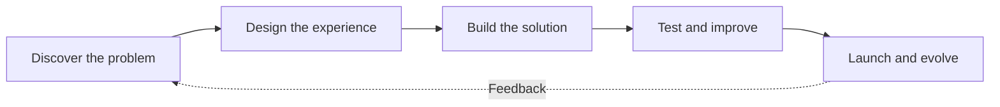

<!-- SOLVARYN LABS — GitHub profile README | Save as README.md in github.com/solvarynlabs/solvarynlabs -->

### From concept to code. From data to intelligence. From ideas to impact.

**We design and engineer modern digital experiences at the intersection of software, artificial intelligence and connected technologies.**

---

## ✦ Who We Are

**Solvaryn Labs** is an Algeria-based software and AI innovation studio. We turn complex challenges into **useful, well-designed and maintainable digital products** — from early prototypes to full-stack applications and connected intelligent systems.

Our approach combines **product thinking, thoughtful UX, practical engineering and data-driven experimentation**. We care about more than delivering features: we aim to create solutions that people can understand, use and trust.

<table>
<tr>
<td width="50%" valign="top">

### 🎯 Our Mission
Make advanced technology more accessible by building intuitive, reliable and meaningful digital solutions.

</td>
<td width="50%" valign="top">

### 🌍 Our Vision
Create locally relevant products with the ambition, engineering quality and versatility to serve a global audience.

</td>
</tr>
</table>

### ⚡ At a Glance

- 🔭 **Currently building:** AI-powered applications, digital platforms and developer-focused tools.
- 🧠 **Exploring:** advanced AI, deep learning, cloud architecture, DevOps, cybersecurity and scalable systems.
- 💬 **Talk to us about:** AI & data science, full-stack development, mobile apps, IoT, UI/UX and product engineering.
- 🤝 **Open to:** product collaborations, software projects, research-driven prototypes and creative technical partnerships.
- 📍 **Based in:** Algeria · Building for a connected world.
- 💡 **Our philosophy:** Technology should solve real problems, not just look impressive.

---

## 🧩 What We Build

| Practice | What we deliver |
|:--|:--|
| 🤖 **AI & Data Science** | Predictive models, intelligent assistants, computer vision prototypes, analytics and AI-enabled product features. |
| 💻 **Web & SaaS** | Responsive websites, admin dashboards, platforms, APIs and scalable full-stack applications. |
| 📱 **Mobile Engineering** | Android and cross-platform apps with thoughtful interfaces and connected services. |
| 🔌 **IoT & Smart Systems** | Sensor-based prototypes, ESP32 integrations, Bluetooth connectivity and real-time monitoring concepts. |
| 🎨 **UI/UX & Product Design** | User journeys, wireframes, design systems, prototypes and usable interfaces. |
| ⚙️ **Automation & Integration** | Workflow automation, service integrations and streamlined business processes. |

---

## 🚀 Selected Projects & Product Concepts

> A selection of products and initiatives associated with our work. **Project maturity varies:** some are prototypes or works in progress, not necessarily public releases.

<table>
<tr>
<td width="50%" valign="top">

### 🧤 NeuroGlove
**HealthTech · IoMT · AI**

A smart medical glove concept combining biomedical sensors, connected monitoring and AI-driven analysis to support research into neurological health indicators.

`ESP32` `BLE` `Sensors` `AI` `Mobile`

</td>
<td width="50%" valign="top">

### 💻 CodeLab
**EdTech · Developer Tools**

A coding and learning environment bringing programming, algorithms, notebooks and embedded-development workflows into one accessible experience.

`Web` `Python` `Java` `Arduino` `Education`

**[Explore CodeLab](https://codelabs.solvaryncareerdz.com)**

</td>
</tr>
<tr>
<td width="50%" valign="top">

### 🩺 MedAtlas DZ
**Medical Education · Digital Learning**

A digital learning concept focused on helping medical students access structured study resources and revision experiences.

`EdTech` `Web` `UX` `Learning`

</td>
<td width="50%" valign="top">

### 🏡 Aqaryoo
**Property Technology · Web Platforms**

A property-oriented digital platform concept with structured listings, location information and user-friendly discovery experiences.

`Full-Stack` `Web` `Dashboard` `UX`

</td>
</tr>
<tr>
<td width="50%" valign="top">

### 👁️ Optic DZ
**Digital Commerce · Product Experience**

A digital experience concept for optical products and services, designed around clear navigation and modern presentation.

`UI/UX` `Web` `Commerce`

</td>
<td width="50%" valign="top">

### 🧠 CardioAI
**AI Research · Medical Imaging**

An experimental machine-learning workflow for medical-image classification and model evaluation. Research prototype, **not a clinical diagnostic product**.

`Python` `TensorFlow` `Computer Vision` `ML`

</td>
</tr>
</table>

**More experiments, interfaces and ideas:**

---

## 🛠️ Technology Toolbox

> Our stack spans product development and experimentation. Individual tools may be used at different levels of depth across projects.

### Languages & Core Development

### Web, Backend & Mobile

### AI, Machine Learning & Data

### Databases, Cloud & Tools

### 🌱 Currently Exploring

`Cloud architecture` · `DevOps` · `Cybersecurity` · `Advanced deep learning` · `Production AI` · `Scalable software design`

---

## 🧭 How We Work

We value **clear communication**, **practical prototypes**, **iterative development**, **maintainable code** and **user-centered design**.

---

## 📊 GitHub Activity

<!-- These cards use the GitHub username 'solvarynlabs'. Third-party stat services can be temporarily unavailable. -->

Statistics are generated by independent services from public GitHub data and may be incomplete or temporarily unavailable.

---

## 🤝 Let's Create Something Meaningful

Have an idea, a product challenge or a collaboration in mind? **Let's discuss how design, software and intelligence can bring it to life.**

### ⚡ A Little Fun Fact

*We don't just write code — we connect creativity, engineering and intelligent systems to make ambitious ideas tangible.*

© Solvaryn Labs · Built with curiosity, care and code.

